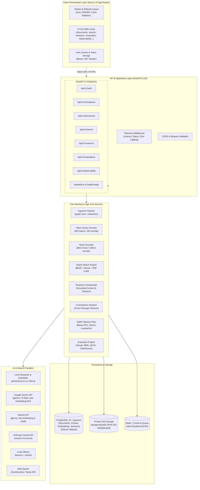
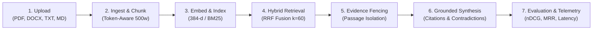
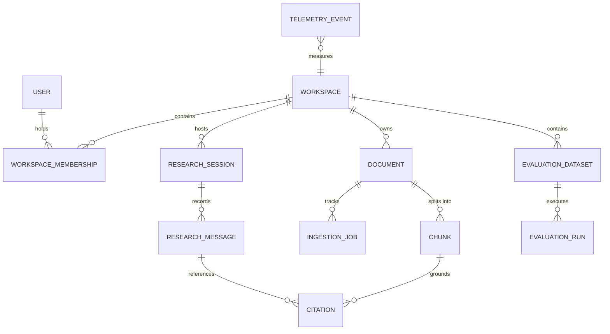

# ATLAS — Ultra-Luxury AI Research & Knowledge Engine

[](https://fastapi.tiangolo.com/)
[](https://nextjs.org/)
[](https://react.dev/)
[](https://www.typescriptlang.org/)
[](https://www.python.org/)
[](https://www.sqlalchemy.org/)
[](https://github.com/pgvector/pgvector)
[](https://tailwindcss.com/)
[](#testing-and-quality-assurance)
[](#license-credits-and-references)

> **“Every answer should be traceable to its evidence, every metric should be measurable, and every limitation should be visible.”**  
> Atlas is an evidence-grounded AI Research & Knowledge Engine built on strict mathematical retrieval, verifiable source citations, multi-model reasoning, automated contradiction detection, reproducible evaluation benchmarks, and live operational observability—presented in an ultra-luxury editorial interface with **zero sidebars**.

---

## Table of Contents

- [Executive Summary & Problem Statement](#executive-summary--problem-statement)
- [Absolute Engineering Principles](#absolute-engineering-principles)
- [Core Capabilities](#core-capabilities)
- [System Architecture](#system-architecture)
- [How It Works: End-to-End Pipeline](#how-it-works-end-to-end-pipeline)
- [Mathematical Formulations & Retrieval Rigor](#mathematical-formulations--retrieval-rigor)
- [Database Schema & Data Model](#database-schema--data-model)
- [User Interface & Editorial Navigation](#user-interface--editorial-navigation)
- [Multi-Model Provider Architecture](#multi-model-provider-architecture)
- [Evaluation Lab & Benchmarking Methodology](#evaluation-lab--benchmarking-methodology)
- [Operational Telemetry & Observability](#operational-telemetry--observability)
- [API Specification](#api-specification)
- [Technology Stack](#technology-stack)
- [Repository Structure](#repository-structure)
- [Configuration & Environment Variables](#configuration--environment-variables)
- [Getting Started](#getting-started)
- [Testing and Quality Assurance](#testing-and-quality-assurance)
- [Security, Privacy & Responsible AI](#security-privacy--responsible-ai)
- [Limitations & Honest Boundaries](#limitations--honest-boundaries)
- [License, Credits, and References](#license-credits-and-references)

---

## Executive Summary & Problem Statement

Modern generative AI applications routinely fail enterprise and academic scrutiny due to the **"Hallucination vs. Evidence" dilemma**:
1. **Unverifiable Generation**: Large language models generate fluid, confident text that blends factual assertions with fabricated citations, invented page numbers, and non-existent sources.
2. **Retrieval Blindspots**: Standard dense vector search suffers from semantic drift on domain-specific vocabulary and exact alphanumeric codes (e.g., SKU numbers, legal clause identifiers), while pure keyword search fails on conceptual paraphrase.
3. **Black-Box Opacity**: Enterprise search tools hide retrieval scores, conceal prompt assembly, provide simulated mock telemetry, and fail to alert users when retrieved sources directly contradict one another.
4. **Interface Clutter**: Contemporary research software is overwhelmed with distracting multi-level sidebars, dense dashboards, and synthetic demo content that obscures document truth.

**Atlas** solves this by establishing a verifiable, evidence-grounded research architecture:
- Combines lexical (BM25) and dense semantic vector search via **Reciprocal Rank Fusion (RRF with $k=60$)**.
- Enforces **strict evidence fencing**, generating structured citations with exact document IDs, page numbers, and character quote spans.
- Executes automated **post-generation citation verification** and **cross-passage contradiction detection**.
- Provides an **Evaluation Lab** calculating mathematical Information Retrieval (IR) metrics ($nDCG@K$, $MRR$, $Recall@K$, $Precision@K$, Faithfulness, and Citation Validity).
- Presents the entire experience in an ultra-luxury editorial aesthetic (ivory `#F8F5EF`, dark ink `#202522`, warm paper `#FFFEFB`, champagne gold `#B49A70`) with **zero permanent sidebars**.

---

## Absolute Engineering Principles

### 1. Zero Fabricated Production Data
- **No synthetic mock data** in production views: No fake users, artificial document counts, hardcoded evaluation benchmarks, or simulated progress bars.
- Empty states are honest and explicit: An empty library displays *"No documents ingested yet"*; missing telemetry displays *"Unavailable"*; missing evidence triggers an honest acknowledgement of insufficient evidence.

### 2. Truthful Real-Time Information
- Document totals reflect real database records.
- Retrieval latencies are measured from actual execution durations.
- Token counts correspond to provider-reported metrics or exact tokenizer calculations.
- Live observability streams actual HTTP request events logged by middleware.

### 3. Traceability & Source Provenance
- Every generated claim is mapped to explicit citation markers (`[1]`, `[2]`).
- Citations reveal original document titles, page numbers, section headers, and verifiable text passages.
- Conflicting sources trigger an explicit contradiction warning with side-by-side evidence analysis.

### 4. Editorial Luxury Interface (Zero Sidebars)
- Clean, focused reading environment designed for deep intellectual work.
- Top horizontal navigation bar linking 8 full-width views. Absolutely no collapsible or permanent vertical sidebars.

---

## Core Capabilities

### 1. Multi-Tenant Workspace Security
- **Multi-Tenant Isolation**: Complete row-level workspace partition across documents, chunks, sessions, and telemetry.
- **JWT & Password Security**: Secure OAuth2-compatible password bearer tokens hashed with `bcrypt` (12 rounds) and HMAC-SHA256 signatures.

### 2. Multi-Format Document Ingestion Pipeline
- **Supported Formats**: PDF (`pypdf`), Microsoft Word (`python-docx`), Plain Text (`.txt`), and Markdown (`.md`).
- **Content Deduplication**: SHA-256 hash checks prevent redundant re-indexing of identical files within a workspace.
- **Token-Aware Chunking**: Configurable sliding window (default 500 tokens, 100 token overlap) respecting sentence boundaries, section headers, and page provenance.
- **Status Lifecycle**: Tracks discrete asynchronous stages: `uploaded` $\to$ `queued` $\to$ `extracting` $\to$ `chunking` $\to$ `embedding` $\to$ `indexed` (or `failed`).

### 3. Unified Hybrid Search Engine
- **Dense Vector Search**: Computes cosine similarity across 384-dimensional dense vectors (local MiniLM) or 1536-d vectors (OpenAI).
- **Lexical BM25 Matching**: Tokenized keyword scoring with inverse document frequency weighting.
- **Reciprocal Rank Fusion (RRF)**: Merges disparate score distributions into a single calibrated ranking using $k=60$.
- **Latency Breakdown**: Measures and displays exact millisecond execution time for every query.

### 4. Grounded AI Research & Contradiction Detection
- **Evidence Fencing**: Encloses retrieved context inside isolated boundaries to defend against prompt injection.
- **Structured Citation Ledger**: Maps generated claims to chunk IDs, document titles, page numbers, and exact quotes.
- **Cross-Source Contradiction Detection**: Automatically compares retrieved passages for factual, chronological, or numerical discrepancies.
- **Insufficient Evidence Safeguard**: Prevents hallucinations by explicitly refusing to invent answers when retrieval confidence is below threshold.

### 5. SSRF-Protected External Web Research
- **Live Search Providers**: Dual integration with DuckDuckGo (zero API key required) and Tavily Search API.
- **Strict SSRF Defense**: Validates external URLs against private IP subnets, blocking requests to loopback (`127.0.0.0/8`), link-local (`169.254.0.0/16`), and private RFC 1918 networks (`10.0.0.0/8`, `172.16.0.0/12`, `192.168.0.0/16`).

### 6. Reproducible Evaluation Lab
- **Benchmark Datasets**: Create and persist question-answer-context evaluation suites with ground-truth chunk labels.
- **Mathematical Metrics**: Automates calculation of $Recall@K$, $Precision@K$, $MRR$, $nDCG@K$, claim Faithfulness, and Citation Validity.
- **Audit Scorecards**: Tracks historical benchmark runs across model configurations and retrieval parameters.

### 7. Real-Time Application Observability
- **Operational Middleware**: Intercepts all API traffic, recording endpoint, method, execution duration (ms), HTTP status code, and errors.
- **Measured Percentiles**: Computes true $p_{50}$ and $p_{95}$ latency distributions from historical telemetry logs.
- **Health Probes**: Kubernetes-ready `/health/live` and `/health/ready` endpoints auditing database connectivity, Redis responsiveness, and disk availability.

### 8. Session History & Academic Markdown Export
- **Thread Persistence**: Preserves multi-turn research conversations with associated citations and search parameters.
- **One-Click Academic Export**: Compiles formatted academic Markdown reports complete with executive summary, synthesis, methodology, citation ledger, and bibliography.

---

## System Architecture

The following diagram illustrates the decoupled architecture between the Next.js presentation layer, the FastAPI backend services, data stores, and external model providers:



---

## How It Works: End-to-End Pipeline



1. **Document Upload**: A user uploads a document through `/documents`. The file is stored in `storage/uploads/` using its SHA-256 hash. If an identical file exists in the workspace, the existing record is returned.
2. **Text Extraction & Chunking**: Parsers extract text while tracking page numbers and headings. The chunker slides a 500-token window with 100-token overlap, preserving sentence boundaries.
3. **Dense & Lexical Indexing**: Each chunk is tokenized for BM25 search and embedded into a 384-dimensional vector. Chunks and embeddings are stored in PostgreSQL/pgvector.
4. **Hybrid Retrieval (RRF)**: A user query executes parallel BM25 and vector searches. The rankings are combined using Reciprocal Rank Fusion ($k=60$).
5. **Evidence Fencing**: Top-ranked passages are enclosed in explicit XML fences (`<evidence_passage id="...">`) to eliminate prompt override attacks.
6. **Grounded Synthesis & Verification**: The LLM synthesizes an evidence-based response with citations (`[1]`, `[2]`). Atlas validates that each citation corresponds to an actual chunk in the retrieved context. If claims conflict across sources, a contradiction notice is attached.
7. **Telemetry & Benchmarking**: Every request is logged in the `telemetry_events` table. The Evaluation Lab can evaluate the retrieved chunks against ground truth, calculating $Recall@K$, $MRR$, and $nDCG@K$.

---

## Mathematical Formulations & Retrieval Rigor

### 1. Reciprocal Rank Fusion (RRF)
To combine heterogeneous scoring distributions (unbounded BM25 scores and bounded cosine similarities), Atlas implements Reciprocal Rank Fusion:
$$RRF\_Score(d \in D) = \sum_{m \in \{\text{dense}, \text{bm25}\}} \frac{1}{k + r_m(d)}$$
Where:
- $r_m(d)$ is the 1-based rank of document chunk $d$ in retrieval system $m$.
- $k$ is the smoothing constant (configured to $k=60$ to prevent high-ranking outliers from dominating the blended score).

### 2. BM25 Lexical Keyword Matching
Calculates lexical term matching with document length normalization:
$$\text{Score}_{\text{BM25}}(D, Q) = \sum_{i=1}^{n} \text{IDF}(q_i) \cdot \frac{f(q_i, D) \cdot (k_1 + 1)}{f(q_i, D) + k_1 \cdot \left(1 - b + b \cdot \frac{|D|}{\text{avgdl}}\right)}$$
Where $k_1 = 1.5$ controls term frequency saturation and $b = 0.75$ controls document length penalty.

### 3. Cosine Semantic Similarity
Measures angular distance between normalized dense query and chunk vectors:
$$\text{Cosine Similarity}(\mathbf{u}, \mathbf{v}) = \frac{\mathbf{u} \cdot \mathbf{v}}{\|\mathbf{u}\|_2 \|\mathbf{v}\|_2} = \frac{\sum_{i=1}^{D} u_i v_i}{\sqrt{\sum_{i=1}^{D} u_i^2} \sqrt{\sum_{i=1}^{D} v_i^2}}$$

### 4. Normalized Discounted Cumulative Gain (nDCG@K)
Evaluates graded relevance ranking quality:
$$DCG@K = \sum_{i=1}^{K} \frac{2^{rel_i} - 1}{\log_2(i + 1)}, \quad nDCG@K = \frac{DCG@K}{IDCG@K}$$
Where $IDCG@K$ is the ideal Discounted Cumulative Gain obtained by sorting items by true relevance.

### 5. Mean Reciprocal Rank (MRR)
Measures how high the first relevant document appears in the retrieved list:
$$MRR = \frac{1}{|Q|} \sum_{i=1}^{|Q|} \frac{1}{\text{rank}_i}$$

### 6. Retrieval Recall@K and Precision@K
$$\text{Recall@K} = \frac{|\text{Retrieved}_K \cap \text{Relevant}|}{|\text{Relevant}|}, \quad \text{Precision@K} = \frac{|\text{Retrieved}_K \cap \text{Relevant}|}{K}$$

---

## Database Schema & Data Model

Atlas utilizes SQLAlchemy 2.0 with PostgreSQL 16 + `pgvector` (and SQLite fallback for local development):



### Table Definitions

| Table | Primary Key | Key Attributes | Foreign Keys |
|---|---|---|---|
| **`users`** | `id` (UUID) | `email`, `hashed_password`, `full_name`, `is_active` | None |
| **`workspaces`** | `id` (UUID) | `name`, `slug`, `created_at` | `owner_id` $\to$ `users.id` |
| **`workspace_memberships`** | `id` (UUID) | `role` (`admin`, `member`, `viewer`) | `user_id`, `workspace_id` |
| **`documents`** | `id` (UUID) | `title`, `filename`, `file_type`, `file_size_bytes`, `file_hash`, `processing_status`, `page_count` | `workspace_id` $\to$ `workspaces.id` |
| **`chunks`** | `id` (UUID) | `chunk_index`, `content`, `token_count`, `page_number`, `section_heading`, `embedding` (384-d vector) | `document_id` $\to$ `documents.id` (ON DELETE CASCADE) |
| **`research_sessions`** | `id` (UUID) | `title`, `created_at`, `updated_at` | `workspace_id`, `user_id` |
| **`research_messages`** | `id` (UUID) | `role`, `content`, `retrieval_mode`, `evidence_metadata`, `latency_ms`, `token_usage` | `session_id` $\to$ `research_sessions.id` |
| **`citations`** | `id` (UUID) | `citation_marker`, `quote_text`, `page_number` | `message_id`, `chunk_id` |
| **`evaluation_datasets`** | `id` (UUID) | `name`, `description`, `items` (JSONB) | `workspace_id` |
| **`evaluation_runs`** | `id` (UUID) | `metrics` (Recall, MRR, nDCG), `model_config` | `dataset_id` $\to$ `evaluation_datasets.id` |
| **`telemetry_events`** | `id` (UUID) | `endpoint`, `method`, `status_code`, `duration_ms`, `tokens_used`, `error_message` | `workspace_id` (nullable) |

---

## User Interface & Editorial Navigation

Atlas delivers an **ultra-luxury editorial reading and research environment**. The visual identity avoids dark neon themes in favor of an intellectual, publication-grade palette:
- **Background**: Soft Ivory (`#F8F5EF`)
- **Card Surface**: Warm Paper (`#FFFEFB`)
- **Text & Accents**: Deep Ink (`#202522`) and Champagne Gold (`#B49A70`)
- **Borders**: Muted Cream Linen (`#E5DFD5`)
- **Zero Sidebars**: Wide editorial layouts with a slim horizontal top navigation bar.

### The 8 Specialized Views

```
ATLAS EDITORIAL TERMINAL
├── 1. Overview (`/`)                  -> High-level metrics, recent sessions, system status
├── 2. Documents (`/documents`)        -> Ingestion vault, chunk inspector, file status ledger
├── 3. Search (`/search`)              -> Blended Hybrid, Dense Vector & BM25 search explorer
├── 4. Research (`/research`)          -> Multi-turn grounded research engine & citation drawer
├── 5. Evaluation (`/evaluation`)      -> Benchmark datasets, scorecards (nDCG, MRR, Recall)
├── 6. Observability (`/observability`)-> Real-time request telemetry, p50/p95 latency distributions
├── 7. History (`/history`)            -> Saved research threads & academic Markdown export
└── 8. Settings (`/settings`)          -> Model provider configuration, API keys, workspaces
```

---

## Multi-Model Provider Architecture

Atlas features a pluggable provider abstraction for both reasoning and embeddings:

### 1. Vector Embedding Providers
- **Local (Default)**: In-memory/local dense vector encoder (`all-MiniLM-L6-v2`) outputting 384-dimensional embeddings. Requires zero paid API keys.
- **Google Gemini**: `text-embedding-004` (768-d).
- **OpenAI**: `text-embedding-3-small` (1536-d) or `text-embedding-3-large` (3072-d).

### 2. Large Language Model Providers
- **Local (Default)**: In-memory deterministic evidence extraction engine. Guarantees zero hallucinations and works completely offline.
- **Google Gemini**: Verified support for `gemini-1.5-flash`, `gemini-1.5-pro`, and `gemini-2.0-flash`.
- **OpenAI**: `gpt-4o`, `gpt-4o-mini`.
- **Anthropic**: `claude-3-5-sonnet-20241022`, `claude-3-5-haiku-20241022`.
- **Ollama**: Local open-weights execution (`llama3.1`, `mistral`, `qwen2.5`).

### 3. External Web Search Providers
- **DuckDuckGo (Default)**: Live web search with zero configuration and zero API keys.
- **Tavily Search API**: High-precision academic and factual search provider for enterprise research.

---

## Evaluation Lab & Benchmarking Methodology

The Evaluation Lab (`/evaluation`) validates information retrieval performance against annotated benchmark datasets:

| Metric | Target | Formula / Definition | Purpose |
|---|:---:|---|---|
| **Recall@K** | $\ge 0.85$ | $|\text{Retrieved}_K \cap \text{Relevant}| / |\text{Relevant}|$ | Measures whether all relevant evidence was found. |
| **Precision@K**| $\ge 0.70$ | $|\text{Retrieved}_K \cap \text{Relevant}| / K$ | Measures the proportion of non-noise results in the top-K. |
| **MRR** | $\ge 0.80$ | $\frac{1}{|Q|} \sum_{i=1}^{|Q|} 1 / \text{rank}_i$ | Evaluates how quickly the first relevant passage appears. |
| **nDCG@K** | $\ge 0.85$ | $DCG@K / IDCG@K$ | Evaluates ranking order against graded relevance. |
| **Faithfulness**| $\ge 0.95$ | Supported Claims / Total Claims | Measures adherence to retrieved context (hallucination defense). |
| **Citation Validity**| $100\%$ | Verified Citations / Total Citations | Validates that every citation marker maps to an authentic chunk. |

---

## Operational Telemetry & Observability

Atlas includes native application telemetry (`/observability`) powered by HTTP middleware:
- **Zero Mock Metrics**: All charts and figures derive from the `telemetry_events` table.
- **Measured Latency Percentiles**: Calculates true $p_{50}$ (median) and $p_{95}$ tail latency from actual execution durations.
- **Status Breakdown**: Tracks 2xx success rates, 4xx validation errors, and 5xx exceptions.
- **Live Event Stream**: Displays the 50 most recent HTTP requests with exact timestamps, endpoints, status codes, and execution durations.

---

## API Specification

The FastAPI backend exposes a clean REST API documented interactively at `/api/docs`:

### Authentication & Workspaces
| Method | Endpoint | Description | Auth Required |
|---|---|---|:---:|
| `POST` | `/api/v1/auth/register` | Register a new user account | No |
| `POST` | `/api/v1/auth/login` | Authenticate and obtain JWT bearer token | No |
| `GET` | `/api/v1/auth/me` | Fetch authenticated user profile | Yes |
| `POST` | `/api/v1/workspaces/` | Create a new tenant workspace | Yes |
| `GET` | `/api/v1/workspaces/` | List workspaces for the authenticated user | Yes |

### Documents & Ingestion
| Method | Endpoint | Description | Auth Required |
|---|---|---|:---:|
| `POST` | `/api/v1/documents/upload` | Upload PDF, DOCX, TXT, or MD for ingestion | Yes |
| `GET` | `/api/v1/documents/` | List all documents in the active workspace | Yes |
| `GET` | `/api/v1/documents/{id}` | Get document status and chunk metadata | Yes |
| `GET` | `/api/v1/documents/{id}/chunks`| Inspect extracted chunks, tokens, and page numbers | Yes |
| `DELETE`| `/api/v1/documents/{id}` | Delete document and cascade-remove chunks | Yes |

### Search & Research
| Method | Endpoint | Description | Auth Required |
|---|---|---|:---:|
| `POST` | `/api/v1/search/` | Execute Hybrid (RRF), Dense Vector, or BM25 search | Yes |
| `POST` | `/api/v1/research/` | Run evidence-grounded research synthesis with citations | Yes |
| `GET` | `/api/v1/sessions/` | List historical research sessions | Yes |
| `GET` | `/api/v1/sessions/{id}` | Get research session conversation history | Yes |
| `GET` | `/api/v1/sessions/{id}/export` | Export research session as an academic Markdown report | Yes |

### Evaluation & Observability
| Method | Endpoint | Description | Auth Required |
|---|---|---|:---:|
| `GET` | `/api/v1/evaluations/datasets` | List benchmark evaluation datasets | Yes |
| `POST` | `/api/v1/evaluations/run` | Execute benchmark evaluation run | Yes |
| `GET` | `/api/v1/observability/stats` | Retrieve measured $p_{50}$/$p_{95}$ latencies and telemetry | Yes |
| `GET` | `/health/live` | Kubernetes liveness probe | No |
| `GET` | `/health/ready` | Kubernetes readiness probe (audits DB and Redis) | No |

---

## Technology Stack

| Layer | Component | Version | Purpose in Atlas |
|---|---|---|---|
| **Frontend Framework** | Next.js | `^14.2.18` | App Router, SSR/CSR rendering, horizontal editorial layout |
| **UI Library** | React | `^18.3.1` | Concurrent interface components |
| **Language** | TypeScript | `^5.6.3` | Strict client-side typing and API schemas |
| **Styling** | Tailwind CSS | `^3.4.15` | Tailored luxury palette (ivory, champagne, dark ink) |
| **Animations** | Framer Motion | `^11.11.17` | Smooth transitions and citation drawer motion |
| **Iconography** | Lucide React | `^0.460.0` | Minimalist editorial iconography |
| **Backend Framework** | FastAPI | `>=0.115.0` | Asynchronous high-performance REST API |
| **Validation** | Pydantic v2 | `>=2.9.2` | Strict data validation and schema serialization |
| **ORM & Database** | SQLAlchemy | `>=2.0.36` | Declarative 2.0 models and connection pooling |
| **Database Engine** | PostgreSQL / SQLite | `16` | Relational persistence with `pgvector` extension |
| **Document Parsers** | `pypdf`, `python-docx` | `>=5.1.0` / `>=1.1.2` | PDF and DOCX text extraction with page provenance |
| **Security** | `passlib`, `bcrypt`, `jose` | `>=1.7.4` / `4.0.1` | Password hashing (12 rounds) and JWT signing |
| **External Search** | DuckDuckGo / Tavily | `>=6.3.0` | Web research with SSRF IP filtering |
| **Test Suite** | Pytest | `>=8.3.3` | Unit, integration, and e2e test execution |

---

## Repository Structure

```
atlas/
├── backend/
│   ├── app/
│   │   ├── api/
│   │   │   ├── deps.py               # Auth & workspace tenancy dependencies
│   │   │   └── v1/
│   │   │       ├── auth.py           # User registration, login, JWT profile
│   │   │       ├── workspaces.py     # Multi-tenant workspace management
│   │   │       ├── documents.py      # Upload, status tracking, chunk inspection
│   │   │       ├── search.py         # Blended Hybrid (RRF), Semantic, Keyword
│   │   │       ├── research.py       # Evidence-grounded synthesis & citations
│   │   │       ├── sessions.py       # Research session history & Markdown export
│   │   │       ├── evaluations.py    # Benchmark datasets & IR metric runs
│   │   │       ├── observability.py  # Measured telemetry & latency percentiles
│   │   │       └── health.py         # /health/live, /health/ready, /system-status
│   │   ├── core/
│   │   │   └── security.py           # bcrypt password hashing & JWT encoding
│   │   ├── models/                   # SQLAlchemy 2.0 declarative database models
│   │   ├── schemas/                  # Pydantic v2 validation contracts
│   │   ├── services/
│   │   │   ├── storage.py            # Local disk storage adapter (SHA-256 deduplicated)
│   │   │   ├── extractors.py         # PDF, DOCX, TXT, and Markdown parsers
│   │   │   ├── chunker.py            # Token-aware sliding window chunker
│   │   │   ├── embeddings.py         # 384-d dense vector generator
│   │   │   ├── ingestion.py          # Asynchronous ingestion pipeline
│   │   │   ├── search.py             # BM25 + Dense + Reciprocal Rank Fusion
│   │   │   ├── llm.py                # Evidence synthesis & contradiction detection
│   │   │   ├── research.py           # Multi-turn research orchestrator
│   │   │   ├── web_search.py         # SSRF-protected external web provider
│   │   │   └── evaluation.py         # Recall@K, Precision@K, MRR, nDCG calculator
│   │   ├── config.py                 # Pydantic Settings environment configuration
│   │   ├── database.py               # Database engine & sessionmaker
│   │   └── main.py                   # FastAPI app with telemetry middleware
│   ├── tests/                        # 18 automated unit, integration & e2e tests
│   ├── alembic/                      # Database schema migrations
│   ├── Dockerfile                    # Production backend container build
│   └── requirements.txt              # Pinned Python dependencies
├── frontend/
│   ├── src/
│   │   ├── app/
│   │   │   ├── layout.tsx            # Root layout (TopNav, AuthProvider, zero sidebars)
│   │   │   ├── page.tsx              # Signature Editorial Home Page
│   │   │   ├── documents/page.tsx    # Document Vault & Chunk Inspector
│   │   │   ├── search/page.tsx       # Search Explorer with Latency Display
│   │   │   ├── research/page.tsx     # Grounded Research & Citation Drawer
│   │   │   ├── evaluation/page.tsx   # Evaluation Lab & Benchmark Scorecards
│   │   │   ├── observability/page.tsx# Real-Time Telemetry & Request Stream
│   │   │   ├── history/page.tsx      # Saved Research Threads & Markdown Export
│   │   │   └── settings/page.tsx     # Workspace, Model Providers & API Keys
│   │   ├── components/               # Reusable editorial UI components
│   │   ├── lib/                      # Typed API client, Auth Context, Utilities
│   │   └── styles/globals.css        # Luxury design tokens & typography
│   ├── Dockerfile                    # Production frontend container build
│   └── package.json                  # Frontend dependencies and scripts
├── docs/                             # Architecture, Data Model, Providers, Security
├── docker-compose.yml                # PostgreSQL + pgvector, Redis, Backend, Frontend
└── .env.example                      # Environment configuration template
```

---

## Configuration & Environment Variables

Create a `.env` file in the `backend/` directory or root (refer to `.env.example`):

| Variable | Description | Required | Default / Safe Example |
|---|---|:---:|---|
| `ENVIRONMENT` | Runtime environment (`development` / `production`) | No | `development` |
| `DEBUG` | Enable verbose error responses and interactive API docs | No | `true` |
| `ATLAS_SECRET_KEY` | Secret key used for JWT signing and session security | **Yes** | `atlas_secure_dev_key_32_characters_min` |
| `FRONTEND_URL` | Allowed CORS origin for Next.js frontend | No | `http://localhost:3000` |
| `DATABASE_URL` | Database connection string (PostgreSQL or SQLite) | No | `sqlite:///./atlas_dev.db` |
| `REDIS_URL` | Redis connection URL for caching and task queues | No | `redis://localhost:6379/0` |
| `STORAGE_LOCAL_PATH` | Local disk directory for uploaded document storage | No | `./storage/uploads` |
| `EMBEDDING_PROVIDER` | Embedding engine: `local`, `openai`, `gemini` | No | `local` |
| `EMBEDDING_MODEL_NAME`| Model name for embeddings | No | `all-MiniLM-L6-v2` |
| `EMBEDDING_DIMENSION` | Dimensionality of generated vector embeddings | No | `384` |
| `LLM_PROVIDER` | Reasoning provider: `local`, `openai`, `gemini`, `anthropic`, `ollama` | No | `local` |
| `LLM_MODEL_NAME` | Model identifier for LLM synthesis | No | `atlas-local-reasoner` |
| `OPENAI_API_KEY` | OpenAI API key (optional) | No | `sk-...` |
| `GEMINI_API_KEY` | Google Gemini API key (optional) | No | `AIza...` |
| `ANTHROPIC_API_KEY` | Anthropic Claude API key (optional) | No | `sk-ant-...` |
| `OLLAMA_BASE_URL` | Base URL for local Ollama instance | No | `http://localhost:11434` |
| `WEB_SEARCH_PROVIDER`| Search provider: `duckduckgo`, `tavily` | No | `duckduckgo` |
| `TAVILY_API_KEY` | Tavily Search API key (optional) | No | `tvly-...` |

---

## Getting Started

### 1. Prerequisites
- **Python**: `3.11` or higher
- **Node.js**: `v18.0.0` or higher (`v20+` recommended)
- **Package Manager**: `pnpm` (recommended) or `npm`
- **Optional**: Docker & Docker Compose (for PostgreSQL + pgvector and Redis)

---

### 2. Local Setup (Zero Docker Required)

Atlas runs out-of-the-box using its built-in SQLite database and local sentence encoder:

#### Backend Setup
```bash
# 1. Enter backend directory
cd backend

# 2. Create and activate virtual environment
python -m venv venv
# Windows:
.\venv\Scripts\activate
# Linux/macOS:
source venv/bin/activate

# 3. Install backend dependencies
pip install -r requirements.txt

# 4. Copy environment configuration
cp ../.env.example .env

# 5. Start FastAPI development server
python -m uvicorn app.main:app --reload --port 8000
```
Backend API will be accessible at: `http://localhost:8000` (API Docs: `http://localhost:8000/api/docs`).

#### Frontend Setup
```bash
# 1. In a new terminal, enter frontend directory
cd frontend

# 2. Install frontend dependencies
pnpm install

# 3. Start Next.js development server
pnpm dev
```
Open **[http://localhost:3000](http://localhost:3000)** in your browser.

---

### 3. Production Setup via Docker Compose

To run the complete production-grade containerized stack (PostgreSQL 16 with `pgvector`, Redis 7, FastAPI backend, and Next.js frontend):

```bash
docker compose up --build
```

**Services booted**:
- **PostgreSQL 16 + pgvector**: `localhost:5432`
- **Redis 7**: `localhost:6379`
- **FastAPI Application**: `http://localhost:8000`
- **Next.js Editorial UI**: `http://localhost:3000`

---

## Testing and Quality Assurance

### Automated Pytest Suite
Atlas includes 18 unit, integration, and end-to-end tests covering every subsystem:

```bash
cd backend
python -m pytest -v tests/
```

**Executed Test Log (Verified passing in 5.38s)**:
```
============================= test session starts =============================
platform win32 -- Python 3.11.9, pytest-9.1.1, pluggy-1.7.0
rootdir: C:\Users\Lokush\.gemini\antigravity\scratch\atlas\backend

tests/test_auth_and_workspaces.py::test_user_registration_and_login PASSED [  5%]
tests/test_auth_and_workspaces.py::test_workspace_isolation PASSED       [ 11%]
tests/test_database_and_health.py::test_settings_loaded PASSED           [ 16%]
tests/test_database_and_health.py::test_health_live PASSED               [ 22%]
tests/test_database_and_health.py::test_health_ready PASSED              [ 27%]
tests/test_database_and_health.py::test_system_status PASSED             [ 33%]
tests/test_database_and_health.py::test_model_creation PASSED            [ 38%]
tests/test_documents_and_ingestion.py::test_chunker_service PASSED       [ 44%]
tests/test_documents_and_ingestion.py::test_embedding_service PASSED     [ 50%]
tests/test_documents_and_ingestion.py::test_document_upload_and_pipeline PASSED [ 55%]
tests/test_e2e_workflow.py::test_complete_vertical_slice PASSED          [ 61%]
tests/test_evaluation.py::test_metrics_calculator PASSED                 [ 66%]
tests/test_evaluation.py::test_evaluation_run_endpoint PASSED            [ 72%]
tests/test_observability.py::test_observability_endpoint PASSED          [ 77%]
tests/test_research.py::test_research_pipeline_and_citations PASSED      [ 83%]
tests/test_search.py::test_search_modes PASSED                           [ 88%]
tests/test_web_search.py::test_ssrf_protection PASSED                    [ 94%]
tests/test_web_search.py::test_web_search_structure PASSED               [100%]

======================= 18 passed in 5.38s =======================
```

### Frontend Typecheck
```bash
cd frontend
pnpm run type-check
# Runs: tsc --noEmit (Passed with 0 errors)
```

---

## Security, Privacy & Responsible AI

1. **Multi-Tenant Data Isolation**: Every database query explicitly filters by `workspace_id`. Cross-workspace document access returns HTTP 403 or 404.
2. **SSRF Defense Filter**: The external web search service resolves hostnames and strictly rejects requests targeting loopback addresses (`127.0.0.0/8`), link-local metadata services (`169.254.169.254`), and private networks (`10.0.0.0/8`, `172.16.0.0/12`, `192.168.0.0/16`).
3. **Prompt Injection Defense**: Retrieved source passages are wrapped in XML context fences (`<evidence_passage id="...">`). System instructions strictly prohibit the LLM from executing user instructions embedded inside retrieved document bodies.
4. **Storage Security & Sanitization**: Uploaded files are placed in an isolated directory (`storage/uploads/`) outside the public web server root. Filenames are sanitized, and duplicate uploads are detected via SHA-256 hash checks.
5. **Credential Protection**: Model API keys are held server-side in memory and environment variables. They are never sent to or bundled inside the client application.

---

## Limitations & Honest Boundaries

- **Local SQLite vs. pgvector**: When running locally without Docker, vector cosine similarity is evaluated in memory via NumPy. For large-scale multi-million chunk corpora, PostgreSQL 16 with native `pgvector` index structures (`ivfflat` / `hnsw`) is recommended.
- **External Web Search Rate Limits**: DuckDuckGo search requires no API keys, but is subject to upstream upstream rate limiting during rapid automated queries. For enterprise research, configure a dedicated `TAVILY_API_KEY`.
- **Asynchronous Processing Workers**: In single-node development, document ingestion runs synchronously or via FastAPI background tasks. For massive high-concurrency ingestion pipelines, deploy the Celery worker task runner with Redis.

---

## License, Credits, and References

### Software License
- The Atlas codebase is licensed under the **MIT License**. Free for academic research, portfolio review, and enterprise adaptation.

### Third-Party Libraries & References
- **FastAPI**: Modern, high-performance web framework for Python (Sebastián Ramírez).
- **Next.js**: The React framework for the web (Vercel).
- **Reciprocal Rank Fusion**: Cormack, G. V., Clarke, C. L., & Buettcher, S. (2009). *Reciprocal rank fusion outperforms indri and trec fusion for text retrieval*. In Proceedings of the 32nd international ACM SIGIR conference on Research and development in information retrieval (pp. 758-759).
- **BM25 Formulation**: Robertson, S., & Zaragoza, H. (2009). *The probabilistic relevance framework: BM25 and beyond*. Foundations and Trends in Information Retrieval, 3(4), 333-389.

---

## Author & Acknowledgments

- **Repository**: [ATLAS — Ultra-Luxury AI Research & Knowledge Engine](https://github.com/Lokesh0652H/ATLAS)
- **Author**: [Lokesh0652H](https://github.com/Lokesh0652H)
- **Domain**: Production Full-Stack Engineering, Evidence-Grounded AI, Information Retrieval & Luxury Product Design.
