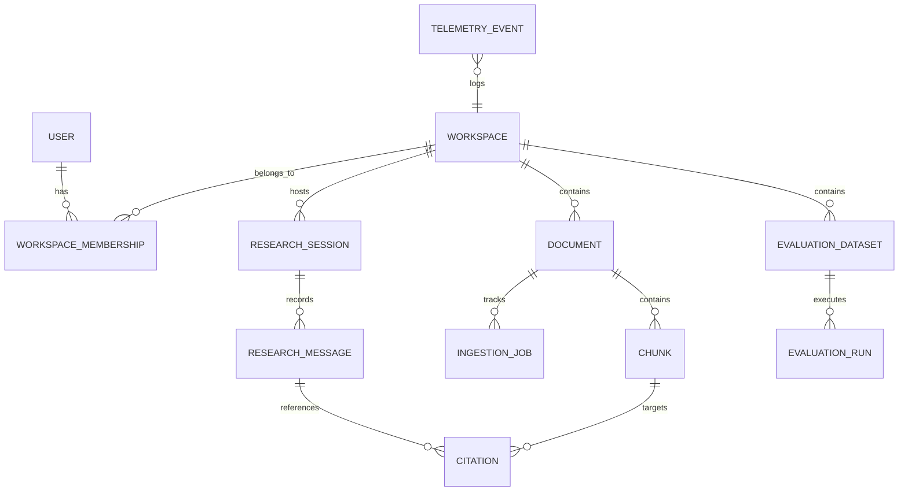

# ATLAS Data Model & Schema Specification

## Entity Relational Diagram

## Key Tables

1. **`users`**:
   - `id` (UUID, PK)
   - `email` (VARCHAR, Unique, Indexed)
   - `hashed_password` (VARCHAR)
   - `full_name` (VARCHAR)
   - `is_active` (BOOLEAN)
   - `created_at`, `updated_at` (TIMESTAMPTZ)

2. **`workspaces`**:
   - `id` (UUID, PK)
   - `name` (VARCHAR)
   - `slug` (VARCHAR, Unique)
   - `owner_id` (UUID, FK -> users.id)
   - `created_at` (TIMESTAMPTZ)

3. **`documents`**:
   - `id` (UUID, PK)
   - `workspace_id` (UUID, FK -> workspaces.id)
   - `title` (VARCHAR)
   - `filename` (VARCHAR)
   - `file_type` (VARCHAR: pdf, docx, txt, md)
   - `file_size_bytes` (INTEGER)
   - `file_hash` (VARCHAR: SHA-256)
   - `storage_path` (VARCHAR)
   - `processing_status` (VARCHAR: uploaded, queued, extracting, chunking, embedding, indexed, failed)
   - `page_count` (INTEGER, nullable)
   - `error_message` (TEXT, nullable)
   - `created_at`, `updated_at` (TIMESTAMPTZ)

4. **`chunks`**:
   - `id` (UUID, PK)
   - `document_id` (UUID, FK -> documents.id, ON DELETE CASCADE)
   - `chunk_index` (INTEGER)
   - `content` (TEXT)
   - `token_count` (INTEGER)
   - `page_number` (INTEGER, nullable)
   - `section_heading` (VARCHAR, nullable)
   - `embedding` (VECTOR(384) or JSON)
   - `created_at` (TIMESTAMPTZ)

5. **`research_sessions`**:
   - `id` (UUID, PK)
   - `workspace_id` (UUID, FK -> workspaces.id)
   - `user_id` (UUID, FK -> users.id)
   - `title` (VARCHAR)
   - `created_at`, `updated_at` (TIMESTAMPTZ)

6. **`research_messages`**:
   - `id` (UUID, PK)
   - `session_id` (UUID, FK -> research_sessions.id, ON DELETE CASCADE)
   - `role` (VARCHAR: user, assistant)
   - `content` (TEXT)
   - `retrieval_mode` (VARCHAR: hybrid, semantic, keyword)
   - `evidence_metadata` (JSONB)
   - `latency_ms` (INTEGER)
   - `token_usage` (JSONB)
   - `created_at` (TIMESTAMPTZ)
